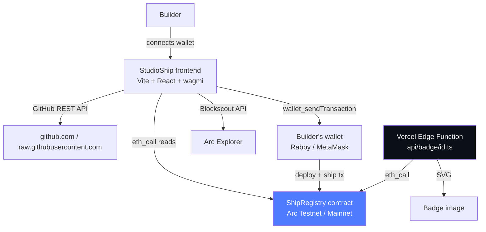

# StudioShip

**Arc Studio builds it. StudioShip ships it.**

A guided tool that takes an Arc Studio project from testnet to mainnet: automated preflight checks, browser-side contract deployment, onchain registration in the ShipRegistry, source verification, and a public gallery of everything shipped.

Built with [Arc Studio](https://studio.arc.io)

---

## Architecture



**Key design rule:** StudioShip never holds keys, never signs transactions, and never stores repository content. All transactions are signed in the builder's own wallet. The registry is self-reported and honest about it — a "Deployer match" indicator shows whether the caller's wallet matches the contract creator, but ownership is never claimed to be proven.

---

## Tech stack

- **Frontend:** React 18, TypeScript (strict), Vite, Tailwind CSS, wagmi v2, viem, ConnectKit
- **Smart contract:** Solidity 0.8.24, Foundry (forge), no external libraries
- **Serverless:** Vercel Edge Functions (badge API only)
- **Checks:** Browser-side preflight via GitHub REST API + raw.githubusercontent.com
- **Explorer:** Blockscout API (Arc Testnet + Mainnet)

---

## Prerequisites

- [Bun](https://bun.sh) ≥ 1.0
- [Foundry](https://book.getfoundry.sh/getting-started/installation) (for contract work)
- A browser wallet (Rabby or MetaMask) on Arc Testnet (chain ID 5042002)

---

## Install & run

```bash
bun install
bun run dev          # Vite dev server on http://localhost:5173
```

---

## Test

```bash
# Preflight check unit tests (vitest)
bun test

# Solidity unit tests (forge, 42 tests)
bun run contracts:test
```

---

## Build

```bash
bunx vite build      # output in dist/
```

---

## Environment variables

Copy `.env.example` to `.env` and fill in the values. Vite exposes every `VITE_` variable to the browser — do not put secrets here.

| Variable | Required | Purpose |
|---|---|---|
| `VITE_NETWORK_MODE` | No | `testnet` (default) or `mainnet` |
| `VITE_REGISTRY_ADDRESS_TESTNET` | No | Overrides the hardcoded testnet registry address |
| `VITE_REGISTRY_ADDRESS_MAINNET` | No | Mainnet registry address (empty = banner shown) |
| `VITE_EXPLORER_URL_MAINNET` | No | Override Arc Mainnet explorer base URL |

**For the Vercel badge function** (`api/badge/[id].ts`), set these in Vercel's environment variable panel (not in `.env`):

| Variable | Required | Purpose |
|---|---|---|
| `REGISTRY_ADDRESS_TESTNET` | Yes | Testnet ShipRegistry address |
| `REGISTRY_ADDRESS_MAINNET` | No | Mainnet ShipRegistry address |

---

## Deploy the registry to mainnet

The testnet registry is already deployed. To deploy to Arc Mainnet yourself:

```bash
# Build the contract
forge build

# Deploy with your own wallet (replace KEY and TREASURY with real values)
forge create contracts/ShipRegistry.sol:ShipRegistry \
  --rpc-url https://rpc.mainnet.arc.io \
  --private-key $PRIVATE_KEY \
  --broadcast \
  --constructor-args \
    <YOUR_TREASURY_ADDRESS> \
    500000000000000000 \
    <YOUR_OWNER_ADDRESS>
```

Then set `VITE_REGISTRY_ADDRESS_MAINNET` and `REGISTRY_ADDRESS_MAINNET` to the deployed address and redeploy the frontend.

---

## Deployed contracts

| Network | Address | Explorer |
|---|---|---|
| Arc Testnet | `0x71a8dd688b38df8e90cde0232114b5d139ac17c5` | [View](https://explorer.testnet.arc.io/address/0x71a8dd688b38df8e90cde0232114b5d139ac17c5) |
| Arc Mainnet | Not yet deployed | — |

---

## After deploying to Vercel — badge function test checklist

1. Open `https://<your-vercel-url>/api/badge/1.svg` — should return a two-part SVG pill badge.
2. If the ship exists and is verified: right label shows "✓ Verified" in green.
3. If the ship exists but is not verified: right label shows "Mainnet" in blue.
4. If the ship does not exist: grey "Unknown" badge.
5. Check the response has `Cache-Control: public, max-age=300`.
6. Add `?network=mainnet` to the URL to switch to mainnet registry reads (once `REGISTRY_ADDRESS_MAINNET` is set).

---

## Security notes

- No private keys are ever requested, stored, or transmitted.
- Secrets found during preflight scanning are masked (`0x1a2b…9f3e`) in all output and never logged.
- The GitHub token (`GITHUB_TOKEN` — not used in the browser build; for a future server route) is optional and only raises rate limits.
- `.env` and `recovery_file*` are in `.gitignore` and must never be committed.
- The registry is self-reported. "Deployer match" is an indicator, not proof of ownership.

---

## Independence disclaimer

StudioShip is an independent community tool. It is not affiliated with, endorsed by, or operated by Circle or Arc.
